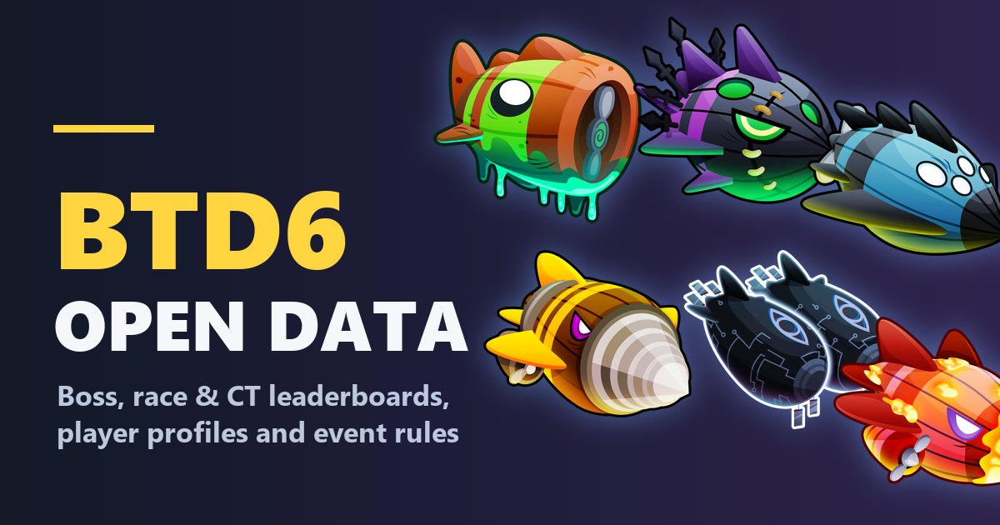

# BTD6 Open Data — live Bloons TD 6 leaderboards, events and tools

**[btd6data.com](https://btd6data.com)** is a free, fast fan site for Bloons TD 6: every boss event, race,
Contested Territory and odyssey with its leaderboards and rules, player and team profiles, and tools built
on the game's own data. It works on phone and desktop, with no ads, no account and nothing to install.

## What's on btd6data.com

- **[Boss events](https://btd6data.com/bosses)**: Standard and Elite leaderboards, rules and top scores for
  every Bloonarius, Lych, Vortex, Dreadbloon, Phayze, Blastapopoulos and Diamondback event, plus
  [boss stats](https://btd6data.com/bosses/bloonarius): health, skulls and spawns per tier.
- **[Races](https://btd6data.com/races)**: leaderboards, fastest times and rules of every race.
- **[Contested Territory](https://btd6data.com/ct)**: player and team leaderboards, tiles and relics.
- **[Odysseys](https://btd6data.com/odyssey)**: islands, rules and rewards.
- **[Challenges](https://btd6data.com/challenges)**: daily challenges, plus the newest and trending
  player-made challenges.
- **[Maps](https://btd6data.com/maps)**: every map, with the boss events and races played on it.
- **Player and team profiles**: medals, badges, stats and Contested Territory history.

### Tools

- **[Round visualizer](https://btd6data.com/tools/rounds)**: the bloons, RBE and spawn timeline of every
  round, straight from the game's round sets.
- **[Paragon degree calculator](https://btd6data.com/tools/paragon)**: how much sacrificed cash, pops,
  towers and totems a degree takes, and the quickest way to the next breakpoint.
- **[Farming](https://btd6data.com/tools/farming)**: when each Banana Farm drops its bananas during a round.

## Why use it

- **Instant**: pages open as soon as you click, and live leaderboards keep updating.
- **Full history**: events stay browsable long after they leave the game.
- **The game's own art**: towers, bosses, maps and relics as you know them.
- **Made for phones** as much as desktops, with light and dark themes.

Have an idea or found a bug? Press **Suggest** at the top of [btd6data.com](https://btd6data.com).

## About

BTD6 Open Data is an unofficial, non-commercial fan project built on Ninja Kiwi's public
[Open Data API](https://data.ninjakiwi.com). It is not affiliated with or endorsed by Ninja Kiwi;
Bloons TD 6 and its art belong to Ninja Kiwi.

For developers: how the site is built is in [docs/architecture.md](docs/architecture.md), and the API
contract it relies on is in [docs/api](docs/api/README.md).
